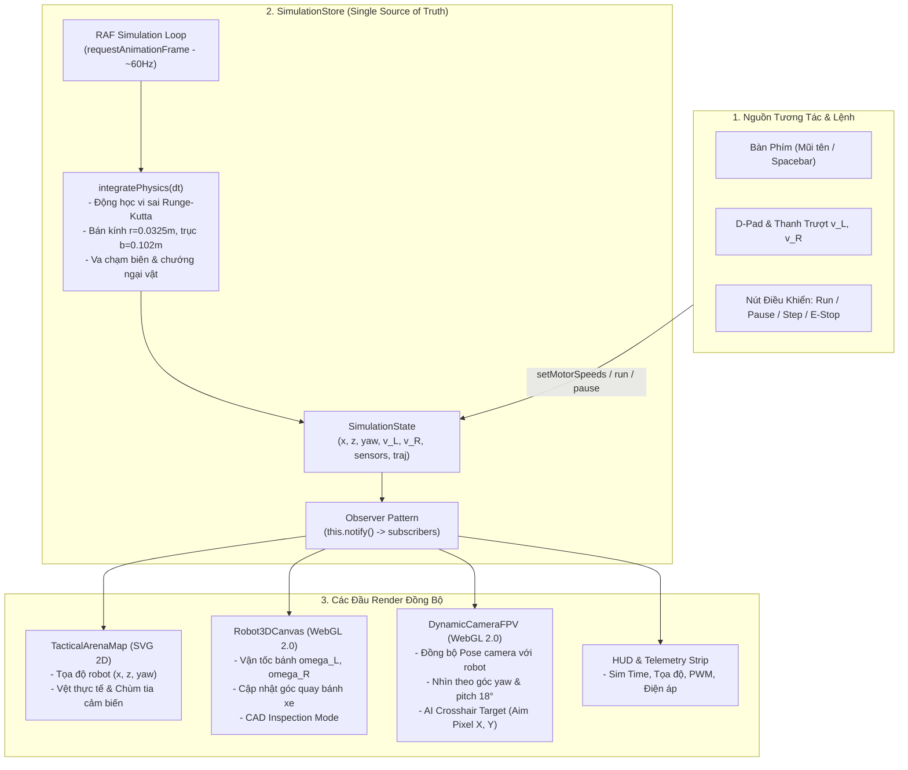

# KIẾN TRÚC HỆ THỐNG ĐỒ HỌA & MÔ PHỎNG (SYSTEM ARCHITECTURE)
**Dự án CMU10 JetBot AI & Robotics Interactive Studio**  
**Giai đoạn**: Phase 3.3 — Simulation & Rendering Architecture Audit

---

## 1. Tổng Quan Kiến Trúc Render Đa Tầng (Multi-Tier Rendering Architecture)

Ứng dụng CMU10 sử dụng mô hình kết hợp (Hybrid Rendering Architecture) bao gồm 4 công nghệ hiển thị song song:

```
+---------------------------------------------------------------------------------------------+
|                                    TRIPLE-VIEW COCKPIT                                      |
+------------------------------------+--------------------------------------------------------+
|           KHUNG A (TRÁI)           |                    KHUNG B & C (PHẢI)                  |
|        Bản Đồ Sa Bàn Đua           +--------------------------------------------------------+
|                                    |                      KHUNG B: 3D ROBOT                 |
|             SVG 2D                 |                       WebGL 2.0                        |
|  (viewBox 0 0 600 400 Vector)      |         (Three.js PBR Mechanical Digital Twin)         |
|  - Đường đua cong Catmull-Rom      +--------------------------------------------------------+
|  - Chướng ngại vật AABB / Vòng tròn |                      KHUNG C: FPV CAMERA               |
|  - Vết bánh xe & Quỹ đạo mẫu       |                       WebGL 2.0                        |
|  - Tọa độ thế giới (X, Z)          |           (Three.js First-Person Robot Vision)         |
+------------------------------------+--------------------------------------------------------+
|                                KHUNG PHỤ DƯỚI (CONTROLS & LOGS)                             |
|                                DOM / HTML5 / Tailwind CSS v4                                |
|    - Bảng điều khiển D-Pad vi sai (v_L, v_R) | Console dòng lệnh Python & Nhật ký Telemetry |
+---------------------------------------------------------------------------------------------+
```

### 1.1. Phân Tầng Công Nghệ Hiển Thị
1. **DOM / CSS (Tailwind v4)**:
   - Đảm nhiệm khung giao diện (Mission Control Bar, Toolbars, Thanh chuyển Layout, D-Pad, Cửa sổ nhật ký mã nguồn Python, Modals cảnh báo an toàn).
   - Hệ thống styling sử dụng CSS Grid và Flexbox kết hợp `react-resizable-panels` cho phép co giãn tỷ lệ động mà không dùng kích thước pixel cố định.
2. **SVG 2D (`TacticalArenaMap.tsx`)**:
   - Thể hiện sa bàn chiến thuật tỷ lệ thực 3.0m × 2.0m qua SVG canvas `viewBox="0 0 600 400"`.
   - Ưu điểm: Độ sắc nét vector tuyệt đối trên mọi độ phân giải màn hình (Retina / 4K), không bị vỡ hạt, chi phí tính toán GPU thấp.
   - Thể hiện: Đường đua, chướng ngại vật LEGO/gỗ/trụ tiêu, vệt bánh xe `actualTrajectory`, quỹ đạo lập kế hoạch `plannedTrajectory`, và chùm tia cảm biến siêu âm.
3. **WebGL 2.0 Canvas 1 (`Robot3DCanvas.tsx`)**:
   - Sử dụng Three.js (v0.186.1) để dựng mô hình song sinh kỹ thuật số (Mechanical Digital Twin) tỷ lệ 1:1 theo thông số CAD chuẩn ISO.
   - Đèn chiếu sáng 3 điểm (Key, Fill, Rim) kết hợp bóng đổ mềm PCF Soft Shadow.
   - Camera Orbit điều khiển xoay, phóng to, thu nhỏ và các góc nhìn thiết lập sẵn (Isometric, Top, Front, Side).
4. **WebGL 2.0 Canvas 2 (`DynamicCameraFPV.tsx`)**:
   - Sử dụng Three.js riêng biệt để mô phỏng camera FPV gắn trên đầu xe robot.
   - Scene 3D bao gồm toàn bộ sàn đấu 3.2m × 2.2m, tường bao quanh, vạch kẻ đường Catmull-Rom và các khối chướng ngại vật đồng bộ vị trí với bản đồ.
   - Camera đặt tại tọa độ mắt thần của JetBot: $X_{cam} = X + 0.065\cos(\psi)$, $Z_{cam} = Z + 0.065\sin(\psi)$, cao độ $Y = 0.088\text{m}$, nghiêng chúc xuống $18^\circ$.

---

## 2. Sơ Đồ Luồng Dữ Liệu Thời Gian Thực (Data Flow Architecture)

Hệ thống tuân thủ nghiêm ngặt nguyên lý **Single Source of Truth** thông qua `simulationStore`:



---

## 3. Phân Tích Vòng Lặp Render (Render Loops & RAF Cycles)

Hệ thống hiện tại có **3 vòng lặp requestAnimationFrame chạy song song độc lập**:

| Tên Vòng Lặp | Vị Trí File | Tần Số Ước Tính | Trách Nhiệm Chính | Nhận Định Kỹ Sư |
|:---|:---|:---:|:---|:---|
| **Physics RAF** | `useSimulationStore.ts:442` | ~60 Hz | Tính toán tích phân động học vi sai, va chạm và gọi `notify()` | Khớp với refresh rate màn hình; tuy nhiên $\Delta t$ biến thiên theo frame time thay vì cố định (Fixed Timestep). |
| **3D Robot RAF** | `Robot3DCanvas.tsx:840` | 60 Hz (khi hoạt động) | Quay bánh xe theo $\omega = v/R$ và render Three.js Scene | Độc lập, có try-catch bảo vệ vòng lặp; tự hủy bằng `cancelAnimationFrame` khi unmount. |
| **FPV Camera RAF** | `DynamicCameraFPV.tsx:187` | 60 Hz | Cập nhật vị trí camera trong 3D và render FPV Scene | Độc lập, truy xuất `simulationStore.getState()` trực tiếp trong RAF loop. |

> [!IMPORTANT]
> **Điểm nghẽn kiến trúc (Architectural Bottleneck)**: Trong khi vòng lặp của Three.js (`Robot3DCanvas` và `DynamicCameraFPV`) tự đọc trực tiếp trạng thái để render mượt mà, thì `simulationStore.notify()` lại kích hoạt `setState` trong React hook ở component cha `TripleViewCockpit`. Điều này làm toàn bộ cây DOM React phải thực hiện quá trình reconciliation 60 lần mỗi giây, tiêu tốn CPU main-thread không cần thiết.

---

## 4. Đánh Giá Hai WebGL Context Cùng Tồn Tại (Dual WebGL Contexts)

Từ dữ liệu runtime của kịch bản audit (Playwright Chromium):
- **Canvas 0** (`Robot3DCanvas`): WebGL 2.0, Renderer: `ANGLE (Intel, Intel(R) Iris(R) Xe Graphics Direct3D11)`.
- **Canvas 1** (`DynamicCameraFPV`): WebGL 2.0, Renderer: `ANGLE (Intel, Intel(R) Iris(R) Xe Graphics Direct3D11)`.
- **Đánh giá tải GPU**:
  - Cả hai context đều hỗ trợ Max Texture Size 16384×16384 và Max Viewport 32767×32767.
  - Việc duy trì 2 WebGL context riêng biệt trên cùng một trang web tiêu tốn khoảng **~35–50 MB VRAM** tổng thể. Trên GPU tích hợp phổ thông (Intel Iris Xe / AMD Radeon Vega / Apple M-series), mức tiêu thụ này hoàn toàn nằm trong ngưỡng an toàn (ngưỡng cảnh báo của trình duyệt là > 8–16 context).
  - Tuy nhiên, khi chuyển qua lại các tab (`home` → `modules` → `robot-sim`), hai component này bị unmount và remount, buộc trình duyệt phải giải phóng và cấp phát lại context. Mã nguồn đã có xử lý `renderer.dispose()` và `forceContextLoss()` giải phóng geometry/material ngăn chặn rò rỉ context.

---

## 5. Cơ Chế Dọn Dẹp Tài Nguyên Khi Unmount / Tab Switch

Tại cả `Robot3DCanvas.tsx` và `DynamicCameraFPV.tsx`:
```typescript
return () => {
  resizeObserver.disconnect();
  window.removeEventListener('resize', handleResize);
  if (animFrameRef.current) cancelAnimationFrame(animFrameRef.current);

  // Deep dispose geometries, materials and textures
  try {
    scene.traverse((object) => {
      if ((object as THREE.Mesh).isMesh) {
        if (object.geometry) object.geometry.dispose();
        if (object.material) {
          if (Array.isArray(object.material)) object.material.forEach((mat) => mat.dispose());
          else object.material.dispose();
        }
      }
    });
    renderer.dispose();
    renderer.forceContextLoss();
  } catch (err) { ... }
};
```
- **Xác minh Runtime**: Khi chuyển đổi liên tiếp 3 tab (`robot-sim` → `home` → `modules` → `robot-sim`), cả hai canvas phục hồi 100% bình thường (`canvases restored after tab switches: true`), không xảy ra lỗi `Context Lost` hay memory leak treo trình duyệt.
