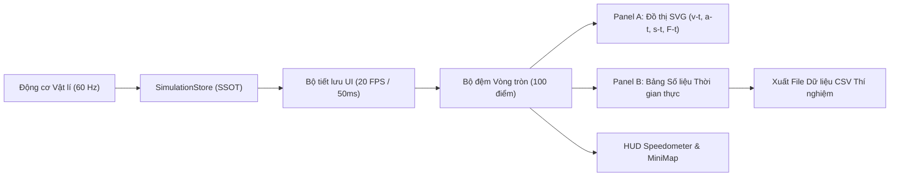

# CMU10 — BÁO CÁO LUỒNG DỮ LIỆU ĐO ĐẠC & ĐỒ THỊ (ANALYTICS DATA FLOW)
## Kiến trúc Dữ liệu Thời gian Thực, Bộ đệm Vòng tròn & Vẽ Đồ thị SVG

- **Dự án:** CMU10 — Phòng thí nghiệm Vật lí 10 & Robot AI JetBot
- **Tài liệu chuẩn:** Phase B Master UI Reconstruction
- **Phiên bản:** V1.0
- **Ngày lập:** 11/10/2026

---

## 1. TỔNG QUAN LUỒNG DỮ LIỆU ĐO ĐẠC

Để phục vụ các bài thực hành định lượng trong chương trình Vật lí 10 (Đo tốc độ, khảo sát gia tốc, kiểm chứng định luật II Newton), hệ thống thiết lập luồng truyền dữ liệu từ động cơ/cảm biến tới các bảng hiển thị như sau:

---

## 2. PANEL A: ĐỒ THỊ ĐỘNG LỰC HỌC VECTOR (PHYSICS CHART PANEL)

Panel A chiếm 5 cột (~41.6% chiều rộng hàng phân tích) và cung cấp các tính năng:
1. **Bộ chuyển đổi đại lượng khảo sát (Metric Switcher):**
   - $v\text{-}t$ (Vận tốc theo thời gian): Khảo sát chuyển động thẳng đều ($v = \text{const}$) và biến đổi đều ($v = v_0 + at$).
   - $a\text{-}t$ (Gia tốc theo thời gian): Nhận diện các giai đoạn tăng tốc, phanh hãm và chuyển động đều ($a = 0$).
   - $s\text{-}t$ (Quãng đường theo thời gian): Đo độ dời tích lũy $s = v_0 t + \frac{1}{2}at^2$.
   - $F\text{-}t$ (Lực kéo theo thời gian): Kiểm chứng định luật II Newton $F_k - F_{ms} = ma$.
2. **Công nghệ vẽ đồ thị SVG mượt mà:**
   - Sử dụng phần tử `<polyline>` và `<path>` nội suy Catmull-Rom mượt mà.
   - Trục toạ độ tự động co giãn dải đo (Auto-scaling) theo giá trị cực đại thực tế.
   - Lưới toạ độ mờ thẩm mỹ, nhãn toạ độ rõ ràng, vạch chỉ số chuẩn mực.

---

## 3. PANEL B: BẢNG SỐ LIỆU THỜI GIAN THỰC (REALTIME DATA TABLE)

Panel B chiếm 4 cột (~33.3% chiều rộng hàng phân tích) và hiển thị các thông số:
- **Thời gian thí nghiệm ($t$):** Độ phân giải $0.1\text{ s}$.
- **Vận tốc tức thời ($v$):** Đơn vị $\text{m/s}$, làm tròn 2 chữ số thập phân.
- **Gia tốc tức thời ($a$):** Đơn vị $\text{m/s}^2$.
- **Quãng đường đi được ($s$):** Đơn vị $\text{m}$.
- **Lực phát động động cơ ($F_k$):** Đơn vị $\text{Newton}$.
- **Nút "Xuất dữ liệu CSV":** Cho phép học sinh tải toàn bộ bảng số liệu thô về máy để vẽ biểu đồ và xử lý sai số trong Excel / Google Sheets theo đúng yêu cầu bài học GDPT 2018.

---

## 4. CHIẾN LƯỢC TỐI ƯU HIỆU NĂNG (PERFORMANCE STRATEGY)
- **Tần số động cơ vật lí:** Chạy ở 60Hz ($dt \approx 16.6\text{ms}$) để đảm bảo tính liên tục của tích phân chuyển động.
- **Tần số cập nhật giao diện (UI Throttle):** Giới hạn ở 20 FPS ($50\text{ms}$) nhằm giảm thiểu hiện tượng nghẽn luồng chính (Main Thread Thrashing) và tránh render React không cần thiết.
- **Kích thước bộ đệm (Ring Buffer):** Giới hạn tối đa 100 điểm dữ liệu gần nhất, sử dụng mảng tĩnh để tránh garbage collection liên tục.
