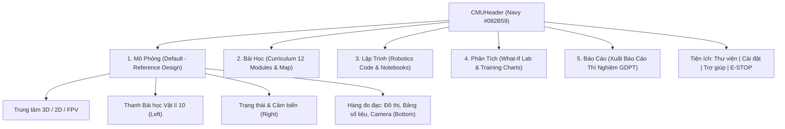

# CMU10 — ĐẶC TẢ KIẾN TRÚC ĐIỀU HƯỚNG (NAVIGATION SPECIFICATION)
## Kiến trúc Phân tầng 5 Cột trụ Giáo dục & Luồng Tương tác CMU10

- **Dự án:** CMU10 — Phòng thí nghiệm Vật lí 10 & Robot AI JetBot
- **Tài liệu chuẩn:** Phase B Master UI Reconstruction
- **Phiên bản:** V1.0
- **Ngày lập:** 11/10/2026

---

## 1. TỔNG QUAN HỆ THỐNG ĐIỀU HƯỚNG

Để chuyển đổi từ giao diện phức tạp nhiều tầng trước đây thành giao diện học tập chuẩn mực và trực quan, CMU10 thiết lập kiến trúc điều hướng **2 cấp độ rõ ràng**:
1. **Cấp độ Toàn cục (Global Level):** Thanh điều hướng đỉnh `CMUHeader` định tuyến giữa **5 Cột Trụ Học Tập STEM**.
2. **Cấp độ Ngữ cảnh (Contextual Level):** Các thanh công cụ nội bộ trong từng không gian làm việc (Viewport Toolbar, Lesson Sidebar, Analytics Switcher).

---

## 2. CHI TIẾT 5 CỘT TRỤ GIÁO DỤC (5 CORE PILLARS)

### 2.1. Cột trụ 1: Mô phỏng (Simulation Workspace - Mặc định)
- **Mục tiêu:** Không gian thực nghiệm trung tâm khớp 100% hình mẫu tham chiếu `cmu10_reference.png`.
- **Trạng thái mặc định:** Mở ngay khi khởi động ứng dụng (`activeTab = 'simulation'`).
- **Luồng tương tác:**
  - Chọn bài học tại `LessonSidebar` -> Khung mô phỏng tự động nạp kịch bản vật lí tương ứng (ví dụ: Bài 2 nạp chuyển động biến đổi đều có gia tốc).
  - Bấm `Chạy` hoặc dùng `D-Pad` -> Robot di chuyển, cập nhật đồng hồ tốc độ HUD, biểu đồ động lực học và bảng số liệu vi sai.
  - Chuyển góc nhìn `2D / 3D / FPV` tức thời mà không làm gián đoạn quỹ đạo chạy của xe.

### 2.2. Cột trụ 2: Bài học (Curriculum & Knowledge Map)
- **Mục tiêu:** Đào sâu lý thuyết, kiến trúc phần cứng và lộ trình 12 chuyên đề JetBot.
- **Phân nhánh nội bộ:**
  - `12 Chuyên Đề Chi Tiết`: Tra cứu giáo trình notebook gốc (`teleoperation`, `collision_avoidance`, `road_following`, ...).
  - `Bản Đồ Mạng Lưới Kiến Thức`: Cây sơ đồ tương tác các module kiến thức Vật lí 10 & Robotics.
  - `Sơ Đồ Hệ Thống & Phần Cứng`: Cấu trúc vi sai I2C, PCA9685, TB6612FNG, Jetson Nano.
- **Nút hành động nhanh:** Nút `Mở Phòng Thí Nghiệm Cho Bài Này ->` tự động đưa người học trở về Tab Mô Phỏng với cấu hình phù hợp.

### 2.3. Cột trụ 3: Lập trình (Code & Interactive Notebooks)
- **Mục tiêu:** Cung cấp môi trường xem mã nguồn Python và thực hành logic điều khiển.
- **Chức năng:** Trình duyệt mã nguồn JetBot Python API, phân tích logic điều khiển vi sai hai bánh `robot.left_motor.value` & `robot.right_motor.value`.

### 2.4. Cột trụ 4: Phân tích (Analytics & What-If Playground)
- **Mục tiêu:** Nghiên cứu tham số thực nghiệm nâng cao.
- **Chức năng:**
  - Phòng thí nghiệm "Nếu Thay Đổi Giá Trị Thì Sao?" (What-If Lab): Tinh chỉnh $K_p, K_d$, độ nhạy lái, khảo sát hiện tượng vọt lố và dao động.
  - Đồ thị huấn luyện AI (Loss & Accuracy) từ mô hình AlexNet và ResNet18.

### 2.5. Cột trụ 5: Báo cáo (Report & Assessment)
- **Mục tiêu:** Đánh giá năng lực học sinh và xuất kết quả thực hành.
- **Chức năng:** Trắc nghiệm kiến thức tổng hợp Vật lí 10 (Quiz Panel), tổng hợp bảng dữ liệu đo đạc thực tế, xuất báo cáo thực hành chuẩn GDPT 2018.

---

## 3. CƠ CHẾ AN TOÀN TOÀN CỤC (GLOBAL E-STOP DOMINANCE)

1. **Vị trí cố định:** Luôn hiển thị ở góc trên bên phải header với màu đỏ cảnh báo (`#DC2626`).
2. **Phím tắt toàn cục:** Phím cách (`Spacebar`) hoặc `Escape`.
3. **Mức độ ưu tiên cao nhất:** Khi kích hoạt:
   - Ngắt ngay lập tức toàn bộ xung động cơ về `0.0`.
   - Chuyển trạng thái mô phỏng sang `EMERGENCY_STOP`.
   - Hiển thị hộp thoại cảnh báo an toàn STEM (`EmergencyStopModal`).
   - Yêu cầu người dùng bấm xác nhận để đưa hệ thống về trạng thái an toàn.
