```mermaid
graph TD
    Root["CMU10 JetBot AI Studio (Vật lí 10)"]

    P1["1. BÀI HỌC (Lessons)"]
    P2["2. MÔ PHỎNG (Simulation - Hub)"]
    P3["3. LẬP TRÌNH (Coding Studio)"]
    P4["4. PHÂN TÍCH (Analytics)"]
    P5["5. ĐÁNH GIÁ (Assessment)"]
    Util["TIỆN ÍCH & AN TOÀN (Utilities)"]

    Root --> P1
    Root --> P2
    Root --> P3
    Root --> P4
    Root --> P5
    Root --> Util

    P1 --> P1_1["Bản Đồ Kiến Thức (Knowledge Map)"]
    P1 --> P1_2["12 Chuyên Đề Chi Tiết (M1 - M12)"]
    P1 --> P1_3["Sơ Đồ Hệ Thống & Phần Cứng (Pipeline)"]

    P2 --> P2_1["Sa Bàn Chiến Thuật 2D (Interactive Map)"]
    P2 --> P2_2["Robot 3D Twin (Three.js CAD Modes)"]
    P2 --> P2_3["Camera FPV (Real-time Vision)"]
    P2 --> P2_4["6 Bố Cục Linh Hoạt (Standard/Focus/Split/Triple/PiP/Full)"]
    P2 --> P2_5["Bảng Điều Khiển D-Pad & Sliders"]

    P3 --> P3_1["Trình Soạn Thảo Python / Code Runner"]
    P3 --> P3_2["Thư Viện Hàm & API (Function Explorer)"]
    P3 --> P3_3["Nhật Ký Lệnh & Tín Hiệu Phần Cứng"]

    P4 --> P4_1["Đồ Thị Động Học Vật Lí 10 (v-t, s-t, a-t)"]
    P4 --> P4_2["Đồ Thị Huấn Luyện AI (Loss, Epoch)"]
    P4 --> P4_3["Sân Chơi Thí Nghiệm Nếu-Như (What-If)"]

    P5 --> P5_1["Trắc Nghiệm Vật Lí 10 & Robotics (Quiz)"]
    P5 --> P5_2["Phiếu Báo Cáo Thí Nghiệm (Lab Report)"]

    Util --> U1["Từ Điển Thuật Ngữ (Glossary)"]
    Util --> U2["Nguồn Tài Liệu & Cảnh Báo (Sources)"]
    Util --> U3["Cài Đặt Giao Diện (Dark/Light, Font Size)"]
    Util --> U4["Dừng Khẩn Cấp Hệ Thống (E-STOP)"]
```

# BÁO CÁO 07: KIẾN TRÚC THÔNG TIN ĐỀ XUẤT (RECOMMENDED INFORMATION ARCHITECTURE)
## CMU10 — JetBot AI & Robotics Interactive Studio (Vật lí 10 STEM)

> **Mục tiêu tài liệu**: Đề xuất sơ đồ kiến trúc thông tin (Information Architecture - IA) chuẩn mực cho giai đoạn Phase B Redesign. Chuyển đổi mô hình 10 tab dàn trải phân mảnh hiện tại thành **5 Trụ Cột Chức Năng Cốt Lõi**, đặt buồng lái mô phỏng làm trung tâm và liên kết chặt chẽ với chương trình Vật lí 10.

---

## 1. Sơ Đồ Kiến Trúc Thông Tin 5 Trụ Cột Đề Xuất (5 Primary Pillars IA)

```
┌────────────────────────────────────────────────────────────────────────────────────────────────────────┐
│                                   CMU10 GLOBAL NAVIGATION BAR                                          │
│  [Logo JetBot] CMU10 Lab 10  │  [1. Bài Học]  [2. Mô Phỏng]  [3. Lập Trình]  [4. Phân Tích]  [5. Đánh Giá] │
│  (STEM Vật lí 10 GDPT 2018)  │  ─────────────────────────────────────────────────────────────────────  │
│                              │  Tiện ích: [Trợ Giúp ?] [Sáng/Tối ☼] [Cỡ chữ A/A+]  [DỪNG KHẨN CẤP ⚠]  │
└────────────────────────────────────────────────────────────────────────────────────────────────────────┘
```



---

## 2. Chi Tiết Từng Trụ Cột Chức Năng

### Trụ Cột 1: BÀI HỌC (Lessons & Knowledge)
- **Mục tiêu sư phạm**: Cung cấp kiến thức nền tảng Vật lí 10 và Robotics theo lộ trình chuẩn.
- **Thành phần tích hợp**:
  - `KnowledgeMap.tsx`: Mạng lưới cây kiến thức trực quan, thể hiện quan hệ tiên quyết giữa các bài.
  - `ModuleDetailView.tsx`: Nội dung chi tiết từng module (M1: Khung sườn, M2: Động học vi sai, M3: Camera CSI, M4: Thu thập dữ liệu, M5: Tránh va chạm, M6: Bám làn đường...).
  - `PipelineDiagram.tsx`: Sơ đồ nguyên lý từ câu lệnh code đến chuyển động bánh xe thực tế.
- **Nâng cấp UX Phase B**: Bổ sung nút **"Mở Thí Nghiệm Cho Bài Này"** để đưa thẳng học sinh sang Buồng Lái Mô Phỏng với bối cảnh bài học đã được cấu hình sẵn.

### Trụ Cột 2: MÔ PHỎNG (Simulation Workspace - Trung Tâm Của Phòng Lab)
- **Mục tiêu sư phạm**: Môi trường thực nghiệm chính (Simulation-First), nơi học sinh quan sát chuyển động thực tế của robot JetBot.
- **Thành phần tích hợp**:
  - `TripleViewCockpit.tsx`: Giữ vai trò buồng lái chỉ huy.
  - `TacticalArenaMap.tsx`: Sa bàn 2D đo đạc tọa độ, đặt đích đến, tính toán quỹ đạo.
  - `Robot3DCanvas.tsx`: Bản sao kỹ thuật số 3D với 7 chế độ kiểm tra CAD (Realistic, Wireframe, Components, Collision, Axes XYZ, Sensor FOV, Dimensions).
  - `DynamicCameraFPV.tsx`: Góc nhìn thứ nhất mô phỏng camera góc rộng 160 độ.
  - Điều khiển: D-Pad, thanh trượt tốc độ hai động cơ, phím mũi tên, phím Spacebar an toàn.
  - Dải HUD Telemetry cách ly: Cập nhật $t, x, z, \psi, \text{PWM}$ mượt mà không gây giật màn hình.

### Trụ Cột 3: LẬP TRÌNH (Coding & Studio)
- **Mục tiêu sư phạm**: Giúp học sinh áp dụng công thức Vật lí 10 vào các câu lệnh Python cụ thể.
- **Thành phần tích hợp**:
  - `FunctionExplorer.tsx`: Tra cứu 30+ hàm của thư viện `jetbot`.
  - Khung soạn thảo mã nguồn Python tích hợp: Soạn thảo, nạp lệnh vào robot mô phỏng và chạy thử.
  - Bảng hiển thị Active Python Code và luồng phần cứng thời gian thực.

### Trụ Cột 4: PHÂN TÍCH (Analytics & Physics Telemetry)
- **Mục tiêu sư phạm**: Rèn luyện kỹ năng xử lý dữ liệu thực nghiệm, vẽ và đọc đồ thị Vật lí 10.
- **Thành phần tích hợp**:
  - Đồ thị động học: Đồ thị vận tốc theo thời gian $v(t)$, quãng đường $s(t)$, gia tốc $a(t)$.
  - `TrainingChartsView.tsx`: Đồ thị học máy phân tích quá trình huấn luyện mạng nơ-ron bám làn.
  - `WhatIfPlayground.tsx`: Thí nghiệm biến đổi hệ số ma sát $\mu$, khối lượng xe $m$, điện áp pin, độ trễ cảm biến.

### Trụ Cột 5: ĐÁNH GIÁ & BÁO CÁO (Assessment & Reports)
- **Mục tiêu sư phạm**: Kiểm tra đánh giá năng lực học sinh và xuất phiếu kết quả thí nghiệm.
- **Thành phần tích hợp**:
  - `QuizPanel.tsx`: 10 câu trắc nghiệm tương tác bám sát nội dung Vật lí 10, giải thích tường minh từng phương án.
  - Báo cáo thí nghiệm: Tổng hợp quãng đường đi được, thời gian hoàn thành sa bàn, số lần va chạm vật cản và đồ thị chuyển động để học sinh lưu nộp cho giáo viên.

---

## 3. Bảng Ánh Xạ Chuyển Đổi (Migration Mapping: 10 Tabs -> 5 Pillars)

| Màn hình hiện tại (Phase 3.6) | Vị trí mới đề xuất trong Phase B | Lợi ích UX đạt được |
| :--- | :--- | :--- |
| `home` (Kiến Thức) | Nhóm **Bài Học** -> Tab con *Bản Đồ Kiến Thức* | Quy tụ toàn bộ nội dung học tập về một nơi duy nhất |
| `modules` (12 Modules) | Nhóm **Bài Học** -> Tab con *12 Chuyên Đề* | Loại bỏ sự phân mảnh giữa bản đồ tổng thể và danh sách bài |
| `pipeline` (Sơ Đồ Quy Trình) | Nhóm **Bài Học** -> Tab con *Phần Cứng & Quy Trình* | Giúp học sinh hiểu cấu tạo JetBot trước khi học code |
| `robot-sim` (Robot 2 Động Cơ) | Nhóm **Mô Phỏng** (Simulation Hub) | Trở thành không gian trung tâm, giải phóng tối đa diện tích |
| `functions` (Thư Viện Hàm) | Nhóm **Lập Trình** -> Tab con *Tra Cứu Lệnh* | Học sinh vừa tra cứu vừa có thể thử nghiệm code ngay |
| `training-charts` (Đồ Thị AI) | Nhóm **Phân Tích** -> Tab con *Đồ Thị Học Máy* | Tách bạch giữa buồng lái điều khiển và phân tích chuyên sâu |
| `what-if` (Thí Nghiệm Nếu-Như) | Nhóm **Phân Tích** -> Tab con *Thí Nghiệm Giả Định* | Kết nối trực tiếp với các bài toán Vật lí 10 biến đổi tham số |
| `quiz` (Trắc Nghiệm) | Nhóm **Đánh Giá** -> Tab con *Kiểm Tra Trắc Nghiệm* | Tạo điểm kết thúc rõ ràng cho chu trình học tập |
| `glossary` (Thuật Ngữ) | Thanh Tiện Ích góc trên -> Hộp thoại *Tra Cứu Thuật Ngữ* | Tiết kiệm 1 mục menu chính, mở nhanh dạng modal tiện lợi |
| `sources` (Nguồn & Lưu Ý) | Thanh Tiện Ích góc trên -> Hộp thoại *Tài Liệu & Phần Cứng* | Đưa các nội dung tham khảo ra khỏi luồng học tập chính |

---

## 4. Kế Hoạch Sửa Chữa Sai Lệch Sư Phạm (Lớp 11 -> Vật lí 10)

Trong giai đoạn thiết kế lại Phase B, các thay đổi văn bản sau là bắt buộc:

1. **Header ứng dụng**: Sửa huy hiệu `Lớp 11` thành `Vật lí 10 STEM`.
2. **Mission Control buồng lái**: Sửa huy hiệu `Lớp 11 STEM` thành `Vật lí 10 • Cơ Học & Robotics`.
3. **Chân trang (Footer)**: Sửa nhãn `Phòng thí nghiệm STEM Colorful EdTech cho học sinh lớp 11` thành `Phòng thí nghiệm STEM Robotics dành cho học sinh Vật lí 10 (GDPT 2018)`.
4. **Chuẩn hóa mục tiêu bài học**: Bổ sung các chuẩn kiến thức Vật lí 10 tương ứng trong từng chuyên đề (Chuyển động thẳng biến đổi đều, Chuyển động tròn đều, Định luật II Newton, Lực hướng tâm, Sai số đo lường).
